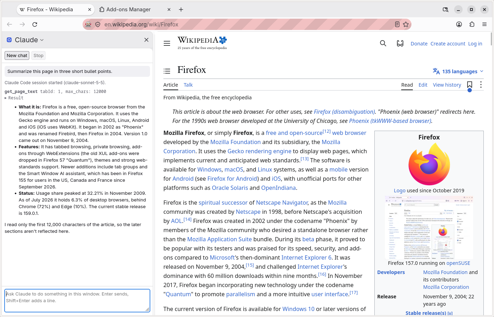
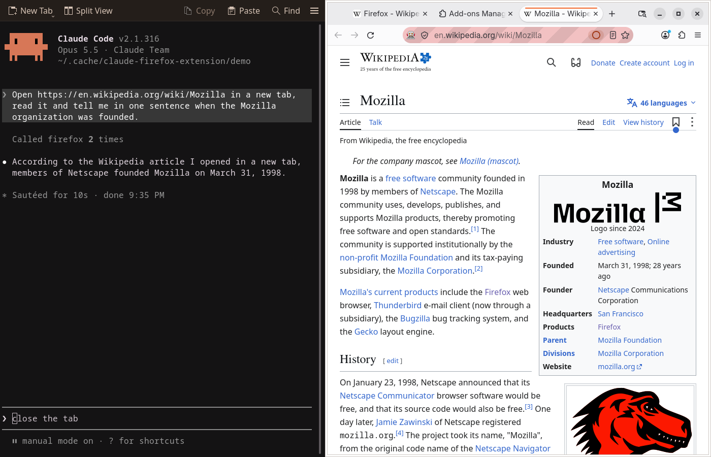
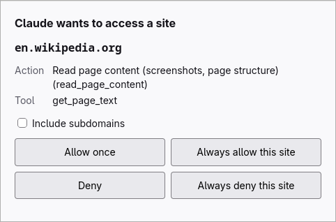
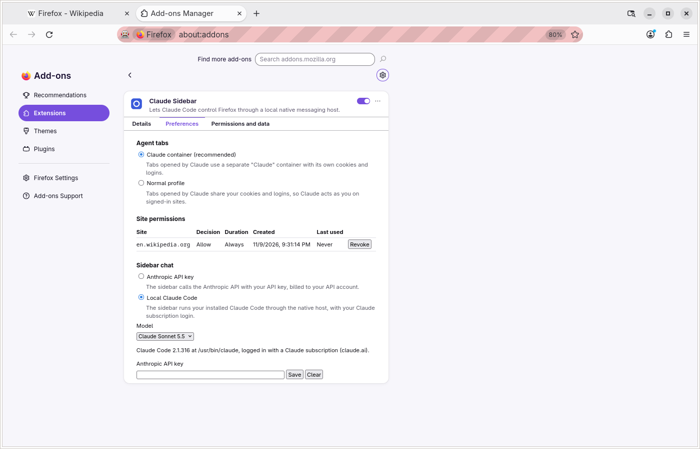

# Claude Sidebar for Firefox

[Русская версия](README.ru.md)

A Firefox extension and a local native host that let [Claude Code](https://docs.anthropic.com/en/docs/claude-code) control your real Firefox: open and close tabs, navigate, read pages, click, type, scroll, take screenshots, run JavaScript and read the console and network requests. The extension also adds a "Claude" sidebar where you can chat with Claude about the current page, either with your own Anthropic API key or through your local Claude Code with your Claude subscription.

The add-on is called "Claude Sidebar" in Firefox. It is an independent project, not made by Anthropic or Mozilla.





| Site permission prompt | Options page |
|---|---|
|  |  |

## Tools

| Tool | What it does |
|---|---|
| `tabs_context` | Lists the open tabs |
| `tabs_create`, `tabs_close` | Opens a background tab, closes a tab |
| `navigate` | Goes to a URL, back or forward |
| `computer` | Screenshot and zoom, left, right, double and triple click, hover, drag, scroll, scroll to an element, type, key presses, wait |
| `read_page` | Accessibility tree of the page with `ref_N` element references |
| `find` | Finds elements by a description |
| `form_input` | Sets the value of a form field by reference |
| `get_page_text` | Main text of the page |
| `javascript_tool` | Runs JavaScript in the page |
| `read_console_messages` | Console messages and errors of a tab |
| `read_network_requests` | Network requests of a tab |
| `resize_window` | Resizes the browser window |

## How it works

```
Claude Code ──MCP (stdio)──> native host ──native messaging──> Firefox extension
                                  │                              ├─ background script
                                  │                              └─ content scripts
                                  └──WebDriver BiDi──> Firefox (trusted input events)
```

- The native host is one program on your machine. Claude Code starts it as an MCP server over stdio, Firefox starts it as a native messaging host, and the two copies talk over a private local socket (a named pipe on Windows) with an authenticated handshake.
- The extension does the browser work: tabs, screenshots, reading pages, console and network capture.
- Extensions cannot produce trusted input events, so clicks, typing and scrolling go through WebDriver BiDi, which needs Firefox started with `--remote-debugging-port`. Without it, input falls back to synthetic DOM events, which many sites ignore.

## Installation

You need Firefox 158 or later and Claude Code. Node.js is not needed. Snap and Flatpak builds of Firefox are not supported: their sandbox blocks native messaging hosts.

### 1. Download

Open the latest release on the [Releases page](https://github.com/SubochArtem/claude-firefox-extension/releases) and download the native host for your system and the extension package:

| System | File |
|---|---|
| Linux x64 | `claude-firefox-host-linux-x64` |
| Linux arm64 | `claude-firefox-host-linux-arm64` |
| macOS Apple silicon | `claude-firefox-host-macos-arm64` |
| macOS Intel | `claude-firefox-host-macos-x64` |
| Windows x64 | `claude-firefox-host-windows-x64.exe` |
| Extension, signed (all systems) | `claude-sidebar-<version>-signed.xpi` |
| Extension, unsigned (all systems) | `claude-firefox-extension-<version>.xpi` |

Optionally check the downloads against `SHA256SUMS` from the same release:

- Linux: `sha256sum -c SHA256SUMS --ignore-missing`
- macOS: `shasum -a 256 -c SHA256SUMS --ignore-missing`
- Windows (PowerShell): `(Get-FileHash <file>).Hash.ToLower()` must equal the hash on the file's line in `SHA256SUMS`.

The signed extension is attached after the release is built and is not listed in `SHA256SUMS`; Firefox checks Mozilla's signature itself.

### 2. Allow the binary to run

The binaries are not code-signed.

- Linux: `chmod +x claude-firefox-host-linux-*`.
- macOS: `chmod +x claude-firefox-host-macos-*`, then remove the download quarantine with `xattr -d com.apple.quarantine claude-firefox-host-macos-*`. Alternatively run it once, let macOS block it, open System Settings > Privacy & Security, click Open Anyway next to the message about the file and run it again.
- Windows: SmartScreen may show "Windows protected your PC" on the first start; click More info, then Run anyway. In PowerShell you can clear the download mark first with `Unblock-File .\claude-firefox-host-windows-x64.exe`.

### 3. Install the native host

Run the downloaded binary with `install` from a terminal in the download folder:

```sh
./claude-firefox-host-linux-x64 install          # Linux (macOS: ./claude-firefox-host-macos-arm64 install)
```

```powershell
.\claude-firefox-host-windows-x64.exe install    # Windows
```

It copies itself into your user data directory, registers that copy with Firefox and prints what it did:

```
Installed the native messaging host:
  manifest: /home/you/.mozilla/native-messaging-hosts/claude_firefox_extension.json
  host:     /home/you/.local/share/claude-firefox-extension/claude-firefox-host

Register the MCP server with Claude Code:
  claude mcp add firefox -- '/home/you/.local/share/claude-firefox-extension/claude-firefox-host' --mcp

Clicks and typing need Firefox started with WebDriver BiDi on port 9222. Close every Firefox window, then run:
  firefox --remote-debugging-port=9222
...
```

The install directory is `~/.local/share/claude-firefox-extension/` on Linux (`$XDG_DATA_HOME` if set), `~/Library/Application Support/claude-firefox-extension/` on macOS and `%LOCALAPPDATA%\claude-firefox-extension\` on Windows. The downloaded file is no longer needed afterwards.

### 4. Register the MCP server with Claude Code

Run the `claude mcp add firefox -- ...` command exactly as `install` printed it (it names the installed copy, quoted for your shell). Restart running Claude Code sessions to pick it up.

### 5. Load the extension

Download `claude-sidebar-<version>-signed.xpi` from the release. It is signed by Mozilla and installs permanently in release Firefox: open the file in Firefox (File > Open File, or drag it into a Firefox window), or in `about:addons` use the gear menu > Install Add-on From File, and confirm the install.

The release also has the unsigned `claude-firefox-extension-<version>.xpi`:

- Release Firefox: open `about:debugging`, This Firefox, Load Temporary Add-on, and pick the `.xpi`. The extension is removed when Firefox closes and has to be loaded again after every start.
- Firefox Developer Edition or Nightly: set `xpinstall.signatures.required` to `false` in `about:config`, then in `about:addons` use the gear menu > Install Add-on From File and pick the `.xpi`. This install is permanent.

### 6. Start Firefox with remote debugging

Clicks, typing and scrolling go through WebDriver BiDi, so close every Firefox window and start Firefox with the command `install` printed:

- Linux: `firefox --remote-debugging-port=9222`
- macOS: `/Applications/Firefox.app/Contents/MacOS/firefox --remote-debugging-port=9222`
- Windows: `"C:\Program Files\Mozilla Firefox\firefox.exe" --remote-debugging-port=9222`

Firefox then shows a robot icon and a striped address bar. To use another port, start Firefox with it and set `CLAUDE_FIREFOX_BIDI_PORT` to that port in the environment Firefox is started from.

### 7. Grant access to websites

Screenshots and page tools need the extension's access to all websites. In `about:addons`, open Claude Sidebar, go to the Permissions tab and turn on "Access your data for all websites". Check this for a temporary install from `about:debugging` too and turn it on if it is off.

The extension still asks before acting on each site: Claude Code shows the question, or Firefox opens a small prompt window.

### Upgrading

Download the new binary and run its `install` as in steps 2 and 3. It replaces the installed copy, even while Firefox or Claude Code still run the old one; restart Firefox and Claude Code to use the new version. The `claude mcp add` registration stays valid. Load the new extension package as in step 5.

The extension id changed to `claude-sidebar@artem.dev`. If your install predates that change, run `install` again after upgrading: the registered manifest allows only the old id. The new id also gets a new storage area, so stored site permissions, the sidebar chat API key, model and backend, and the agent tabs setting are not carried over: set them again in the options page.

### Uninstalling

Close Firefox and Claude Code, then run `uninstall` with the installed or a downloaded binary, for example:

```sh
~/.local/share/claude-firefox-extension/claude-firefox-host uninstall
```

It removes the Firefox registration and the installed files. Then remove the MCP server with `claude mcp remove firefox` and the Claude Sidebar extension in `about:addons`.

## Using the sidebar

Open the "Claude" sidebar with View > Sidebar or the sidebar button. The chat acts on the active tab of the sidebar's window. Enter sends, Shift+Enter adds a line, Stop interrupts, New chat starts over. Closing the sidebar ends the conversation. Choose the backend in the extension's options (`about:addons`, Claude Sidebar, Options).

### With an Anthropic API key

1. In the options, under "Sidebar chat", choose "Anthropic API key", save your Anthropic API key and pick a model. The key is stored unencrypted in your Firefox profile.
2. Click "Grant access" for api.anthropic.com (the sidebar offers the same button).
3. Open the sidebar and type a prompt.

### With local Claude Code

The sidebar can run your installed Claude Code instead of calling the API with a key:

1. Install Claude Code 2.1.302 or newer and log in with your Claude account: run `claude` in a terminal and log in, or run `claude auth login`. Only a Claude subscription login is used; an API key or a cloud provider login is not.
2. In the options, choose "Local Claude Code" under "Sidebar chat". The model chosen there applies to this mode too. The status line below shows whether Claude Code was found and is logged in.
3. Open the sidebar and type a prompt. The native host starts Claude Code for the conversation; "New chat" ends it. If Claude Code is not found, set `CLAUDE_FIREFOX_CLAUDE_PATH` to its full path in the environment Firefox is started from.

In this mode site permissions are always asked in a small Firefox prompt window, not in Claude Code.

## Security and permissions

- **Site permissions.** Every action on a website (navigating, reading, clicking, typing, running JavaScript, reading console or network) needs that site's permission. You answer allow or deny, once or always, optionally for all subdomains, in Claude Code or in a Firefox prompt window; no answer within about 120 seconds counts as deny. A stored deny always wins. Only `http` and `https` pages can be used. Stored permissions are listed in the options page, each with a Revoke button.
- **Claude container.** Tabs the agent opens go into a separate "Claude" container by default, with its own cookies and logins, so the agent is not signed in to your accounts. The options page can switch this to your normal profile. The agent can still navigate and close any tab, including yours, with the site permission check above.
- **Page content is untrusted.** Web pages can contain text written to mislead the agent (prompt injection). Site permissions limit what a misled agent can reach; grant "always" only to sites you trust.
- **Remote debugging port.** With `--remote-debugging-port`, the WebDriver BiDi endpoint on `127.0.0.1` is unauthenticated: any local process, including processes of other users on the same machine, can drive the browser while no other session is active. Firefox shows the robot icon and a striped address bar and reports `navigator.webdriver = true` to every page, so sites can detect automation. Start Firefox this way only when you need input actions.
- **Local bridge.** The native host and the MCP server talk over a socket only your user can open (a randomly named pipe on Windows), with a per-start secret and a mutual handshake. Any program running as your user is trusted and can use it.
- **Data.** Page text, screenshots, console and network output, your clicks and typing, and URLs are sent to the native host and on to Claude Code, or to api.anthropic.com with your key. Firefox shows these data categories at install.

## Building from source

Requires Node.js 24 or later. Run every command from `src/`:

```sh
cd src
npm install
npm run build            # bundle the extension into dist/extension and the host into dist/host
npm run typecheck
npm test                 # Vitest, no Firefox or network needed
npm run lint             # web-ext lint on dist/extension (build first)
npm run start            # run the built extension in a temporary Firefox profile
npm run install-host     # register the development build as the native host, prints the claude mcp add command
npm run uninstall-host
npm run build:binary     # single executable dist/bin/claude-firefox-host for this platform (build first)
npm run smoke:binary
```

`npm run build:binary` embeds the running Node; use an official Node build, since a distribution Node linked against shared system libraries gives a binary that needs them.

`npm run e2e` runs an end-to-end check in a real headless Firefox. It changes the native host registration, so it runs only with `CI=true` or `--force`, and a local `--force` run is Linux only, inside a temporary `HOME` and `XDG_RUNTIME_DIR` under `/tmp`:

```sh
RT=$(mktemp -d /tmp/cfe-rt-XXXX); H=$(mktemp -d /tmp/cfe-home-XXXX); HOME=$H XDG_RUNTIME_DIR=$RT npm run e2e -- --force --binary
```

## License

[MIT](LICENSE)
