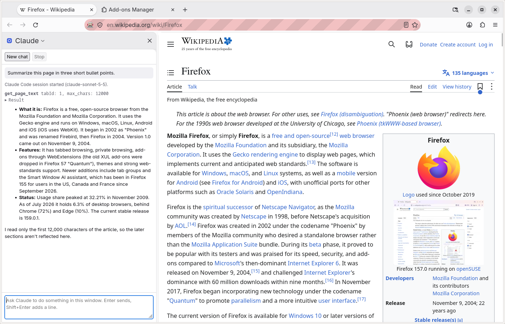
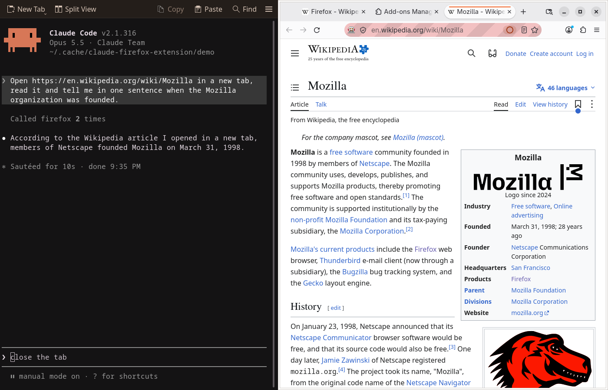
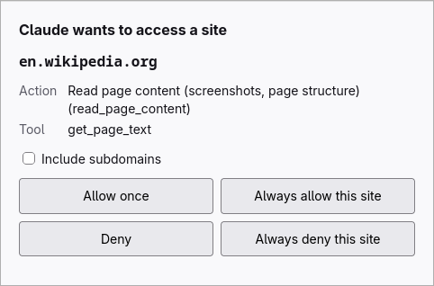
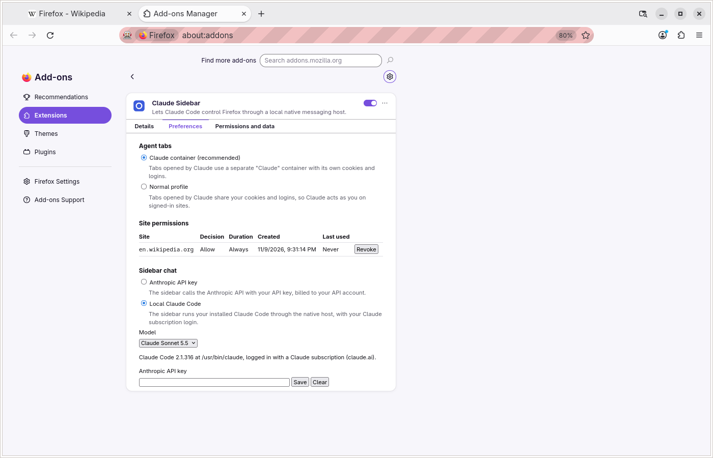

# Claude Sidebar для Firefox

[English version](README.md)

Расширение Firefox и локальный нативный хост, которые позволяют [Claude Code](https://docs.anthropic.com/en/docs/claude-code) управлять вашим настоящим Firefox: открывать и закрывать вкладки, переходить по адресам, читать страницы, кликать, печатать, прокручивать, делать скриншоты, выполнять JavaScript и читать консоль и сетевые запросы. Расширение также добавляет боковую панель «Claude», где можно общаться с Claude о текущей странице: со своим ключом Anthropic API или через локальный Claude Code с вашей подпиской Claude.

В Firefox дополнение называется «Claude Sidebar». Это независимый проект, он не сделан Anthropic или Mozilla.





| Запрос разрешения для сайта | Страница настроек |
|---|---|
|  |  |

## Инструменты

| Инструмент | Что делает |
|---|---|
| `tabs_context` | Список открытых вкладок |
| `tabs_create`, `tabs_close` | Открывает фоновую вкладку, закрывает вкладку |
| `navigate` | Переходит по URL, назад или вперёд |
| `computer` | Скриншот и увеличение, левый, правый, двойной и тройной клик, наведение, перетаскивание, прокрутка, прокрутка к элементу, ввод текста, нажатия клавиш, ожидание |
| `read_page` | Дерево доступности страницы со ссылками на элементы `ref_N` |
| `find` | Ищет элементы по описанию |
| `form_input` | Задаёт значение поля формы по ссылке |
| `get_page_text` | Основной текст страницы |
| `javascript_tool` | Выполняет JavaScript на странице |
| `read_console_messages` | Сообщения и ошибки консоли вкладки |
| `read_network_requests` | Сетевые запросы вкладки |
| `resize_window` | Меняет размер окна браузера |

## Как это работает

```
Claude Code ──MCP (stdio)──> native host ──native messaging──> Firefox extension
                                  │                              ├─ background script
                                  │                              └─ content scripts
                                  └──WebDriver BiDi──> Firefox (trusted input events)
```

- Нативный хост — одна программа на вашем компьютере. Claude Code запускает её как MCP-сервер через stdio, Firefox запускает её как хост native messaging, и две копии общаются через приватный локальный сокет (на Windows — именованный канал) с аутентифицированным рукопожатием.
- Расширение выполняет работу в браузере: вкладки, скриншоты, чтение страниц, сбор консоли и сетевых запросов.
- Расширения не могут создавать доверенные события ввода, поэтому клики, ввод текста и прокрутка идут через WebDriver BiDi, а для этого Firefox нужно запустить с `--remote-debugging-port`. Без него ввод переходит на синтетические DOM-события, которые многие сайты игнорируют.

## Установка

Нужны Firefox 158 или новее и Claude Code. Node.js не нужен. Сборки Firefox из Snap и Flatpak не поддерживаются: их песочница блокирует хосты native messaging.

### 1. Скачайте

Откройте последний релиз на [странице Releases](https://github.com/SubochArtem/claude-firefox-extension/releases) и скачайте нативный хост для вашей системы и пакет расширения:

| Система | Файл |
|---|---|
| Linux x64 | `claude-firefox-host-linux-x64` |
| Linux arm64 | `claude-firefox-host-linux-arm64` |
| macOS Apple silicon | `claude-firefox-host-macos-arm64` |
| macOS Intel | `claude-firefox-host-macos-x64` |
| Windows x64 | `claude-firefox-host-windows-x64.exe` |
| Расширение, подписанное (все системы) | `claude-sidebar-<version>-signed.xpi` |
| Расширение, неподписанное (все системы) | `claude-firefox-extension-<version>.xpi` |

При желании проверьте загрузки по файлу `SHA256SUMS` из того же релиза:

- Linux: `sha256sum -c SHA256SUMS --ignore-missing`
- macOS: `shasum -a 256 -c SHA256SUMS --ignore-missing`
- Windows (PowerShell): `(Get-FileHash <file>).Hash.ToLower()` должен совпасть с хешем в строке этого файла в `SHA256SUMS`.

Подписанное расширение прикладывается после сборки релиза и в `SHA256SUMS` не входит; подпись Mozilla Firefox проверяет сам.

### 2. Разрешите запуск бинарника

Бинарники не подписаны сертификатом разработчика.

- Linux: `chmod +x claude-firefox-host-linux-*`.
- macOS: `chmod +x claude-firefox-host-macos-*`, затем снимите карантин загрузки командой `xattr -d com.apple.quarantine claude-firefox-host-macos-*`. Или запустите файл один раз, дайте macOS его заблокировать, откройте «System Settings > Privacy & Security», нажмите «Open Anyway» рядом с сообщением о файле и запустите снова.
- Windows: при первом запуске SmartScreen может показать «Windows protected your PC»; нажмите «More info», затем «Run anyway». В PowerShell можно заранее снять отметку загрузки командой `Unblock-File .\claude-firefox-host-windows-x64.exe`.

### 3. Установите нативный хост

Запустите скачанный бинарник с `install` из терминала в папке загрузки:

```sh
./claude-firefox-host-linux-x64 install          # Linux (macOS: ./claude-firefox-host-macos-arm64 install)
```

```powershell
.\claude-firefox-host-windows-x64.exe install    # Windows
```

Он копирует себя в каталог данных пользователя, регистрирует эту копию в Firefox и выводит, что сделал:

```
Installed the native messaging host:
  manifest: /home/you/.mozilla/native-messaging-hosts/claude_firefox_extension.json
  host:     /home/you/.local/share/claude-firefox-extension/claude-firefox-host

Register the MCP server with Claude Code:
  claude mcp add firefox -- '/home/you/.local/share/claude-firefox-extension/claude-firefox-host' --mcp

Clicks and typing need Firefox started with WebDriver BiDi on port 9222. Close every Firefox window, then run:
  firefox --remote-debugging-port=9222
...
```

Каталог установки: `~/.local/share/claude-firefox-extension/` на Linux (`$XDG_DATA_HOME`, если задан), `~/Library/Application Support/claude-firefox-extension/` на macOS и `%LOCALAPPDATA%\claude-firefox-extension\` на Windows. Скачанный файл после этого больше не нужен.

### 4. Зарегистрируйте MCP-сервер в Claude Code

Выполните команду `claude mcp add firefox -- ...` в точности так, как её вывел `install` (в ней указана установленная копия в кавычках для вашей оболочки). Перезапустите работающие сессии Claude Code, чтобы они её подхватили.

### 5. Загрузите расширение

Скачайте `claude-sidebar-<version>-signed.xpi` из релиза. Он подписан Mozilla и устанавливается навсегда в обычном Firefox: откройте файл в Firefox («File > Open File» или перетащите его в окно Firefox) или в `about:addons` выберите в меню шестерёнки «Install Add-on From File», и подтвердите установку.

В релизе есть и неподписанный `claude-firefox-extension-<version>.xpi`:

- Обычный Firefox: откройте `about:debugging`, «This Firefox», «Load Temporary Add-on» и выберите `.xpi`. Расширение удаляется при закрытии Firefox, и его нужно загружать заново после каждого запуска.
- Firefox Developer Edition или Nightly: установите `xpinstall.signatures.required` в `false` в `about:config`, затем в `about:addons` выберите в меню шестерёнки «Install Add-on From File» и укажите `.xpi`. Такая установка постоянная.

### 6. Запустите Firefox с удалённой отладкой

Клики, ввод и прокрутка идут через WebDriver BiDi, поэтому закройте все окна Firefox и запустите его командой, которую вывел `install`:

- Linux: `firefox --remote-debugging-port=9222`
- macOS: `/Applications/Firefox.app/Contents/MacOS/firefox --remote-debugging-port=9222`
- Windows: `"C:\Program Files\Mozilla Firefox\firefox.exe" --remote-debugging-port=9222`

После этого Firefox показывает значок робота и полосатую адресную строку. Чтобы использовать другой порт, запустите Firefox с ним и задайте этот порт в `CLAUDE_FIREFOX_BIDI_PORT` в окружении, из которого запускается Firefox.

### 7. Дайте доступ к сайтам

Скриншотам и инструментам страниц нужен доступ расширения ко всем сайтам. В `about:addons` откройте Claude Sidebar, вкладку «Permissions and data» и включите «Access your data for all websites». Проверьте это и для временной установки из `about:debugging` и включите, если выключено.

Расширение всё равно спрашивает перед действием на каждом сайте: вопрос показывает Claude Code, или Firefox открывает небольшое окно запроса.

### Обновление

Скачайте новый бинарник и запустите его `install`, как в шагах 2 и 3. Он заменяет установленную копию, даже пока Firefox или Claude Code ещё работают со старой; перезапустите Firefox и Claude Code, чтобы использовать новую версию. Регистрация `claude mcp add` остаётся в силе. Загрузите новый пакет расширения, как в шаге 5.

Идентификатор расширения сменился на `claude-sidebar@artem.dev`. Если ваша установка старше этой смены, после обновления снова запустите `install`: зарегистрированный манифест разрешает только старый идентификатор. Новый идентификатор получает и новое хранилище, поэтому сохранённые разрешения сайтов, ключ API, модель и бэкенд чата в боковой панели и настройка вкладок агента не переносятся: задайте их заново на странице настроек.

### Удаление

Закройте Firefox и Claude Code, затем запустите `uninstall` установленным или скачанным бинарником, например:

```sh
~/.local/share/claude-firefox-extension/claude-firefox-host uninstall
```

Он удаляет регистрацию в Firefox и установленные файлы. Затем удалите MCP-сервер командой `claude mcp remove firefox` и расширение Claude Sidebar в `about:addons`.

## Боковая панель

Откройте боковую панель «Claude» через «View > Sidebar» или кнопку боковой панели. Чат работает с активной вкладкой окна этой панели. Enter отправляет, Shift+Enter добавляет строку, «Stop» прерывает, «New chat» начинает заново. Закрытие панели завершает разговор. Бэкенд выбирается в настройках расширения (`about:addons`, Claude Sidebar, «Options»).

### С ключом Anthropic API

1. В настройках в разделе «Sidebar chat» выберите «Anthropic API key», сохраните свой ключ Anthropic API и выберите модель. Ключ хранится в профиле Firefox в незашифрованном виде.
2. Нажмите «Grant access» для api.anthropic.com (боковая панель предлагает ту же кнопку).
3. Откройте боковую панель и введите запрос.

### С локальным Claude Code

Боковая панель может запускать установленный у вас Claude Code вместо вызовов API с ключом:

1. Установите Claude Code 2.1.302 или новее и войдите в свой аккаунт Claude: запустите `claude` в терминале и войдите или выполните `claude auth login`. Используется только вход по подписке Claude; ключ API или вход через облачного провайдера не используются.
2. В настройках выберите «Local Claude Code» в разделе «Sidebar chat». Выбранная там модель действует и в этом режиме. Строка состояния ниже показывает, найден ли Claude Code и выполнен ли вход.
3. Откройте боковую панель и введите запрос. Нативный хост запускает Claude Code для разговора; «New chat» его завершает. Если Claude Code не найден, задайте полный путь к нему в `CLAUDE_FIREFOX_CLAUDE_PATH` в окружении, из которого запускается Firefox.

В этом режиме разрешения сайтов всегда запрашиваются в небольшом окне Firefox, а не в Claude Code.

## Безопасность и разрешения

- **Разрешения сайтов.** Каждое действие на сайте (переход, чтение, клик, ввод, выполнение JavaScript, чтение консоли или сети) требует разрешения этого сайта. Вы отвечаете «разрешить» или «запретить», один раз или всегда, при желании для всех поддоменов, в Claude Code или в окне запроса Firefox; отсутствие ответа примерно за 120 секунд считается запретом. Сохранённый запрет всегда главнее. Работать можно только со страницами `http` и `https`. Сохранённые разрешения показаны на странице настроек, у каждого есть кнопка «Revoke».
- **Контейнер Claude.** Вкладки, которые открывает агент, по умолчанию попадают в отдельный контейнер «Claude» со своими cookies и входами, поэтому агент не авторизован в ваших аккаунтах. На странице настроек это можно переключить на обычный профиль. Агент всё равно может переходить по адресам и закрывать любую вкладку, включая ваши, с проверкой разрешения сайта, описанной выше.
- **Содержимое страниц не доверенное.** Веб-страницы могут содержать текст, написанный, чтобы ввести агента в заблуждение (prompt injection). Разрешения сайтов ограничивают то, до чего может дотянуться обманутый агент; давайте «всегда» только сайтам, которым доверяете.
- **Порт удалённой отладки.** С `--remote-debugging-port` точка WebDriver BiDi на `127.0.0.1` не требует аутентификации: любой локальный процесс, включая процессы других пользователей того же компьютера, может управлять браузером, пока не открыта другая сессия. Firefox показывает значок робота и полосатую адресную строку и сообщает каждой странице `navigator.webdriver = true`, так что сайты могут распознать автоматизацию. Запускайте Firefox так, только когда нужны действия ввода.
- **Локальный мост.** Нативный хост и MCP-сервер общаются через сокет, который может открыть только ваш пользователь (на Windows — канал со случайным именем), с секретом, новым при каждом запуске, и взаимным рукопожатием. Любая программа, работающая от вашего пользователя, считается доверенной и может им пользоваться.
- **Данные.** Текст страниц, скриншоты, вывод консоли и сети, ваши клики и ввод, а также URL передаются нативному хосту и дальше в Claude Code или на api.anthropic.com с вашим ключом. Firefox показывает эти категории данных при установке.

## Сборка из исходников

Нужен Node.js 24 или новее. Все команды запускаются из `src/`:

```sh
cd src
npm install
npm run build            # собрать расширение в dist/extension и хост в dist/host
npm run typecheck
npm test                 # Vitest, Firefox и сеть не нужны
npm run lint             # web-ext lint для dist/extension (сначала build)
npm run start            # запустить собранное расширение во временном профиле Firefox
npm run install-host     # зарегистрировать сборку для разработки как нативный хост, выводит команду claude mcp add
npm run uninstall-host
npm run build:binary     # единый исполняемый файл dist/bin/claude-firefox-host для этой платформы (сначала build)
npm run smoke:binary
```

`npm run build:binary` встраивает запущенный Node; используйте официальную сборку Node, поскольку Node из дистрибутива, слинкованный с общими системными библиотеками, даёт бинарник, которому они нужны.

`npm run e2e` выполняет сквозную проверку в настоящем headless Firefox. Она меняет регистрацию нативного хоста, поэтому запускается только с `CI=true` или `--force`, а локальный запуск с `--force` работает только на Linux, внутри временных `HOME` и `XDG_RUNTIME_DIR` в `/tmp`:

```sh
RT=$(mktemp -d /tmp/cfe-rt-XXXX); H=$(mktemp -d /tmp/cfe-home-XXXX); HOME=$H XDG_RUNTIME_DIR=$RT npm run e2e -- --force --binary
```

## Лицензия

[MIT](LICENSE)
